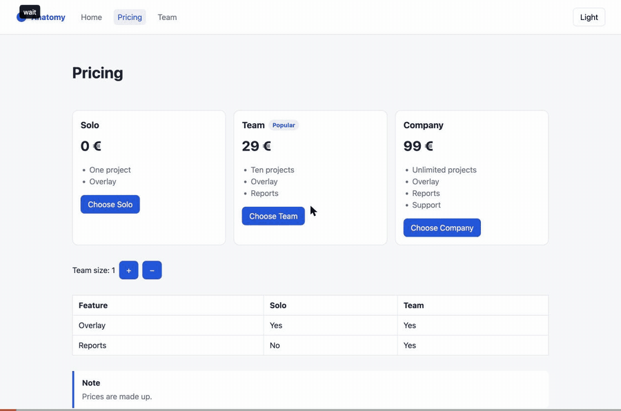

# jaspr_anatomy

See which components make up a rendered [Jaspr](https://jaspr.site) page, and where reuse is missing.

- **For people:** an overlay on the live page. Outlines and names for every component, a 3D view that stacks them by nesting, and a panel with the tree, the component inventory and reuse findings.
- **For coding agents:** the same tree and findings as Markdown or JSON, from the command line, without a browser.

It is a development tool. It adds nothing to release builds and nothing to a page that does not ask for it.

Inspired by [React Anatomy](https://react-anatomy.com/). Requires Jaspr 0.24 and Dart 3.13.



## Set up

Add the package. It is not on pub.dev yet, so use a git or path dependency:

```yaml
dependencies:
  jaspr_anatomy:
    path: ../jaspr_anatomy
```

Wrap the page body in `Anatomy`:

```dart
import 'package:jaspr_anatomy/jaspr_anatomy.dart';

runApp(
  Document(
    title: 'My app',
    body: Anatomy(child: App()),
  ),
);
```

That is the whole integration for what the server renders. It works the same with `renderComponent` and custom shelf servers. `Anatomy` must sit inside the body, not around `Document`.

To also see what `@client` components build in the browser after the page has loaded (after a click, for example), wrap the client root as well:

```dart
// lib/main.client.dart
runApp(const Anatomy(child: ClientApp()));
```

A client-mode app, which renders nothing on the server, wraps its root the same way, `runApp(Anatomy(child: App()))`, and gets the overlay from the client alone: `?anatomy` or Alt+Shift+A turns it on. In the browser `enabled` defaults to `kDebugMode` too, so a release build of the client leaves it off unless you pass `enabled: true`. Debug builds of the client carry the overlay program (about 230 KB) for client-mode apps; release builds leave it out, so keeping `Anatomy` around the client root costs about 2.5 KB there. A client-mode app therefore gets the overlay in debug builds only.

## Use the overlay

Run the app in debug mode (`jaspr serve`, or `dart run` on your server) and either:

- press **Alt+Shift+A** on any page, or
- open any page with `?anatomy` added to the URL.

The page reloads with the overlay. It stays on as you navigate, until you press **Off** in the panel.

| | |
|---|---|
| **2D** | Outlines over the real page, one colour per component class. Move the pointer over a component to light up every other instance of it. |
| **3D** | The page as layers, lifted by nesting depth. Drag to turn, Shift-drag to move, wheel to zoom. **Pixels** switches between the page's own content and plain tinted layers. |
| **Tree** | Every component instance, nested as rendered. |
| **Components** | Every component class with its instance count. |
| **Reuse** | Repeated markup and where inline markup accumulates. Click a finding to mark its copies on the page: green where a component renders it, red where it is written inline. |

Other controls:

- **Pick**, or Alt-click at any time, selects a component on the page. The details show its source file as a link that opens your editor.
- **Project / + Packages / + Framework** chooses which components count. Project means code in your repository, including local path packages.
- **Depth** limits how deeply nested components are drawn.
- **Alt+Shift+A** hides and shows the overlay. **Esc** clears the selection.

## Use it from the command line

Two commands. Neither needs a browser.

```sh
# Which components make up these pages, and what repeats?
dart run jaspr_anatomy:inspect http://localhost:8080/ http://localhost:8080/pricing

# Start at one page and follow links until 20 pages are read.
dart run jaspr_anatomy:inspect http://localhost:8080/ --crawl 20

# Which component classes exist, and where is each constructed?
dart run jaspr_anatomy:scan
```

`inspect` asks the running server for each page and reports:

- totals, and the share of elements that come from components used more than once;
- every component class: instances, pages, how many elements it writes itself, where it is used, source file and line;
- components with a single instance that write a lot of markup themselves;
- repeated markup (see below);
- the component tree of each page.

`scan` reads source, so the app does not have to run. It covers the app and the local packages it depends on, and reports components that nothing constructs, components constructed in one place, the most used ones, and how much of each shared package the app puts to use. It saves its result in `.dart_tool/jaspr_anatomy/scan.json`; `inspect` then adds an "In code" column.

Useful options: `--json` for machine-readable output, `--scope packages|all`, `--elements` to show HTML elements in the tree, `--cookie` and `--header` for pages behind a login or a host check. Run either command with `--help` for the rest.

In a browser session, the overlay exposes the same data:

```js
window.__jasprAnatomy.snapshot()   // the page tree, with positions
window.__jasprAnatomy.report()     // the Markdown report of this page
window.__jasprAnatomy.analysis()   // components and findings as an object
window.__jasprAnatomy.show('3d')   // also '2d', hide(), off()
```

Agents can load `skills/jaspr-anatomy/SKILL.md` for how to work with these.

## Reading the reuse findings

Two pieces of markup count as the same structure when their root elements and the direct children of those roots have the same tags and classes. What is deeper may differ, as it does between two uses of one component.

| Finding | Meaning | Usual fix |
|---|---|---|
| **Inline markup duplicates a component** | Markup written by hand has the structure an existing component renders. | Use the component there. |
| **Twin components** | Two component classes render the same structure. | Merge them. |
| **Repeated inline markup** | The same styled structure appears several times and no component renders it. | Extract a component. |

Structure that appears once in every instance of a component is not reported: that is the component being reused. Unstyled structure such as table rows is not reported either.

## Options

```dart
Anatomy(
  child: App(),
  enabled: kDebugMode,                         // the default
  hotkey: true,                                // the default
  editorUrl: 'vscode://file/{file}:{line}',    // the default
)
```

- `enabled` decides whether the tool is available at all. `kDebugMode` is false in release builds and in ahead-of-time compiled servers. If your production server runs from source without Jaspr's release flag, pass your own condition.
- `hotkey: false` removes the Alt+Shift+A listener, so that pages are byte-for-byte what they would be without the wrapper. Turn anatomy on with `?anatomy` instead.
- `editorUrl` is the link behind source locations. For IntelliJ and Android Studio use `idea://open?file={file}&line={line}`.

## How it works

1. The server renders the page as usual. Afterwards `Anatomy` walks the finished component tree below it and writes it down as JSON: components, the elements they rendered, truncated text.
2. For a request that asked for anatomy, the server appends that JSON and the overlay program after the app's HTML. The app's own markup is not touched: no wrapper elements, no attributes, no comments.
3. In the browser the overlay runs before Jaspr's client script. It walks the JSON and the DOM in step to find the element for every described node, then draws from their positions. Hydration afterwards reuses the same elements, so the overlay keeps working and the app is not disturbed.

A request asks for anatomy with the `jaspr_anatomy` cookie (set by the hotkey and by `?anatomy`), the `?anatomy` query parameter, or an `X-Jaspr-Anatomy` header (`data` for the JSON alone, which is what `inspect` sends).

Component names, libraries and source lines are read on the server, so a minified client build makes no difference.

When the client root is wrapped too, the client program offers its live component tree to the overlay. The overlay asks for it whenever the page changes and puts each `@client` component's live subtree in place of what the server described, keeping the server's names, origins and source lines for classes the server rendered. Classes only the browser ever built get the name the compiler kept: the real one in development builds, `minified:Xy` in a minified build.

## Limits

- **Later browser changes need the client root wrapped.** Without `Anatomy` around the client root, the tree is the page as the server rendered it. With it, a `@client` component that takes server-rendered children keeps the server's description, because the client does not see inside those children.
- **Client-mode apps have names only.** No server means no source lines or origins, so the Project filter shows every class that is not Jaspr's own.
- **Source locations need a server run from source** (`jaspr serve`, `dart run`). They are read through `dart:mirrors`, which ahead-of-time compiled servers do not have; there you get names only.
- **Raw HTML** (`RawText`, `raw()`) is a black box: the tool knows something is there, not what.
- **A strict Content-Security-Policy** that forbids inline scripts blocks the overlay. `inspect` still works.
- **The 3D view with pixels is a copy.** Pseudo-elements, canvas content, video and iframes are missing or blank, and layers are ordered by nesting, not by `z-index`. Very large pages are copied only in part.
- **Two classes with the same name** in different libraries are told apart only when source locations are available.
- Built against Jaspr 0.24, which is a beta. The server part uses Jaspr's render-adapter API, which may still change.

## Development

```sh
dart pub get
dart analyze
dart test                              # server, analysis and scan tests
dart test -p chrome test/overlay       # overlay tests, in Chrome
dart run tool/build_overlay.dart       # after changing lib/src/overlay or lib/src/core
```

The overlay is a Dart program in `lib/src/overlay/`, compiled to JavaScript and checked in as `lib/src/server/overlay_bundle.g.dart`, so apps using the package need no extra build step. `dart run tool/build_overlay.dart --check` fails when the bundle is older than its sources.

`example/` is a small site with deliberate reuse problems to try the tool on.
